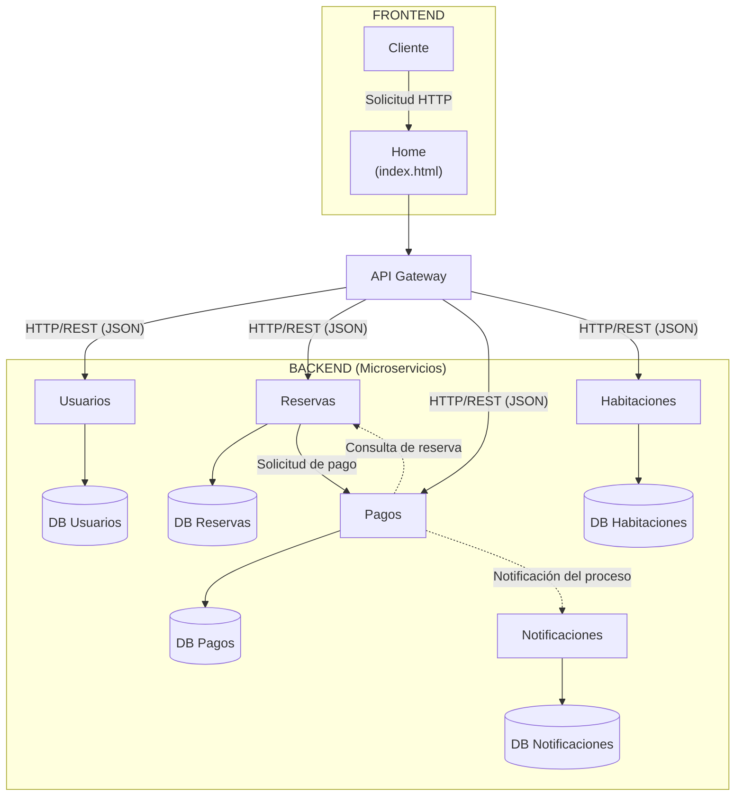

# Arquitectura del Sistema: Hotel Alma Blanca – Reservas de Hoteles

## Problema que resuelve

Este proyecto busca permitir a los clientes consultar las habitaciones disponibles en el hotel y realizar reservaciones de una forma intuitiva y sencilla.
El sistema ayuda a gestionar las reservas del hotel, incluyendo la disponibilidad de habitaciones, reservas, pagos y confirmaciones, evitando depender de procesos manuales.

## Objetivo
Ofrecer a los clientes una plataforma para consultar habitaciones, realizar reservas y gestionar pagos, mediante una arquitectura distribuida basada en microservicios.

## Integrantes y roles
| Integrante | Rol |
|---|---|
| Maira Yarlin García Rivera | Líder del proyecto |
| Andrés Casanova Rengifo | Encargado de frontend |
| Yisel Verónica Pajoy Maca | Encargada técnica |
| Danilo Alexander Collazos Alegría | Encargado de documentación |

## Contenido del repositorio

| Ruta | Contenido |
|---|---|
| `home/` | Sitio estático servido por Nginx; incluye `index.html`, estilos, JavaScript y recursos gráficos. |
| `servicios/gateway/` | API Gateway Flask que recibe las llamadas del navegador y las reenvía a los microservicios. |
| `servicios/usuarios/` | API Flask y acceso a PostgreSQL para los usuarios. |
| `servicios/habitaciones/` | API Flask y acceso a PostgreSQL para las habitaciones. |
| `servicios/reservas/` | API Flask, disponibilidad, reservas y llamadas a Usuarios y Habitaciones. |
| `servicios/pagos/` | API Flask, cálculo de pagos y llamada a Reservas. |
| `servicios/notificaciones/` | API Flask y persistencia de notificaciones. |
| `docs/arquitectura/` | Documento PDF de arquitectura del proyecto. |
| `docker-compose.yml` | Definición de Home, gateway, microservicios, bases de datos, puertos y volúmenes. |
| `.env.example` | Plantilla de configuración para crear el archivo local `.env`. |

## Arquitectura

Nuestro proyecto se basa en una arquitectura de **microservicios**. El **Cliente** accede a la aplicación mediante **Home**, que envía las solicitudes al **API Gateway**. El Gateway recibe y enruta las peticiones hacia los microservicios del backend mediante comunicación **HTTP/REST con JSON**.

La arquitectura contempla los microservicios de **Usuarios, Habitaciones, Reservas, Pagos y Notificaciones**, cada uno encargado de una funcionalidad específica del sistema. A su vez, cada microservicio cuenta con su **propia base de datos**, manteniendo el aislamiento de la información y evitando que otros servicios accedan directamente a ella.

### Diagrama de arquitectura



Cada microservicio administra su propia base de datos. El API Gateway recibe las solicitudes del Home y las enruta mediante HTTP/REST con mensajes JSON. Reservas se integra con Pagos y Pagos comunica los eventos correspondientes a Notificaciones.

### Contenido de la página Home

La página de inicio es una web responsive con HTML, CSS y JavaScript, servida en el puerto `3000`. Presenta:

* Barra de navegación con accesos a Inicio donde se visualiza historias de Popayán, Habitaciones, Reservas, Registro e inicio de sesión.
* Portada del hotel con fotografía de la Torre del Reloj, texto introductorio y botones para iniciar una reserva o descubrir Popayán.
* Buscador de reserva con fechas de entrada y salida, número de huéspedes, selección de habitación y huésped titular. Valida capacidad y fechas, consulta disponibilidad y permite confirmar la reserva.
* Galería de sitios turísticos de Popayán: Parque Caldas, Puente del Humilladero, Morro de Tulcán, calles del centro, iglesia de Santo Domingo y Semana Santa.
* Tarjetas de habitaciones con foto, tipo, número, capacidad, precio por noche y estado; las habitaciones en mantenimiento no se pueden seleccionar.
* Tabla de reservas con huésped, habitación, fechas, personas, estado y pago, además de la acción para eliminar una reserva.
* Formularios para registrar huéspedes y pagos asociados a una reserva, con selección del método de pago y visualización del total y el estado.
* Avisos de tolerancia a fallos para los circuit breakers de Reservas y Pagos, y pie de página con el equipo y créditos de las fotografías.

## Servicios del sistema

* **Servicio de Usuarios:** Gestiona el registro y la información de clientes, recepcionistas y administradores.
* **Servicio de Habitaciones:** Gestiona las habitaciones y su disponibilidad.
* **Servicio de Reservas:** Gestiona las reservas realizadas y consulta la disponibilidad de habitaciones y los datos del cliente.
* **Servicio de Pagos:** Consulta los detalles de una reserva, calcula el monto según las noches y el precio por noche, y registra el pago con su método y estado.
* **Servicio de Notificaciones:** Recibe y administra las notificaciones asociadas a los procesos de reservas y pagos, y conserva sus registros.

Cada servicio mantiene responsabilidades y persistencia propias, e intercambia datos con los demás mediante sus APIs.

### Funcionalidades de los servicios

* Usuarios permite consultar, registrar, actualizar y eliminar usuarios.
* Habitaciones permite consultar, registrar, actualizar y eliminar habitaciones.
* Reservas permite consultar, crear, actualizar y eliminar reservas, revisar la disponibilidad y consultar detalles de una reserva.
* Pagos permite listar, consultar y registrar pagos asociados a reservas.
* Notificaciones permite crear, consultar, actualizar y eliminar registros relacionados con el flujo de reservas y pagos.

## Endpoints de la API

Las rutas siguientes corresponden a las APIs de los microservicios y reciben o devuelven JSON cuando aplica. `{id}` representa el identificador numérico del recurso. El API Gateway centraliza las solicitudes del Home y las dirige al servicio correspondiente.

### Usuarios

Base URL local: `http://localhost:5001`

| Método | Endpoint | Descripción | Entrada principal |
|---|---|---|---|
| `GET` | `/usuarios` | Lista los usuarios. | Ninguna. |
| `GET` | `/usuarios/{id}` | Consulta un usuario por ID. | ID en la URL. |
| `POST` | `/usuarios` | Registra un usuario con rol cliente por defecto. | JSON con `nombre`, `apellido`, `documento`, `email` y `telefono`. |
| `PUT` | `/usuarios/{id}` | Actualiza todos los datos del usuario. | JSON con los campos requeridos del usuario. |
| `PATCH` | `/usuarios/{id}` | Actualiza parcialmente los datos enviados. | JSON con uno o más campos del usuario. |
| `DELETE` | `/usuarios/{id}` | Elimina un usuario. | ID en la URL. |
| `GET` | `/usuarios/{id}/reservas` | Consulta un usuario y solicita sus reservas al servicio Reservas. | ID del usuario en la URL. |
| `GET` | `/usuarios/circuito` | Consulta el estado del circuit breaker hacia Reservas. | Ninguna. |

Ejemplo del cuerpo para `POST /usuarios`:

```json
{
  "nombre": "Marcos",
  "apellido": "Rodriguez",
  "documento": "1001001005",
  "email": "marcos@example.com",
  "telefono": "3097647698"
}
```

### Habitaciones

Base URL local: `http://localhost:5003`

| Método | Endpoint | Descripción | Entrada principal |
|---|---|---|---|
| `GET` | `/health` | Comprueba que el servicio responda. | Ninguna. |
| `GET` | `/habitaciones` | Lista las habitaciones. | Ninguna. |
| `GET` | `/habitaciones/{id}` | Consulta una habitación por ID. | ID en la URL. |
| `POST` | `/habitaciones` | Crea una habitación. | JSON con `numero`, `tipo`, `capacidad`, `precio_noche`, `estado` y, opcionalmente, `descripcion`. |
| `PUT` | `/habitaciones/{id}` | Actualiza los datos de una habitación. | JSON con `numero`, `tipo`, `capacidad`, `precio_noche`, `estado` y, opcionalmente, `descripcion`. |
| `DELETE` | `/habitaciones/{id}` | Elimina una habitación. | ID en la URL. |

Ejemplo del cuerpo para `POST /habitaciones`:

```json
{
  "numero": "401",
  "tipo": "doble",
  "capacidad": 2,
  "precio_noche": 150000,
  "estado": "disponible",
  "descripcion": "Habitación con baño privado"
}
```

### Reservas

Base URL local: `http://localhost:5002`

| Método | Endpoint | Descripción | Entrada principal |
|---|---|---|---|
| `GET` | `/reservas` | Lista las reservas. | Ninguna. |
| `GET` | `/reservas/{id}` | Consulta una reserva por ID. | ID en la URL. |
| `GET` | `/reservas/{id}/detalles` | Consulta la reserva junto con los datos del usuario y la habitación obtenidos de sus servicios. | ID en la URL. |
| `GET` | `/reservas/disponibilidad` | Comprueba disponibilidad para un intervalo. | Query params: `habitacion_id`, `fecha_entrada`, `fecha_salida`. |
| `POST` | `/reservas` | Valida usuario, habitación y disponibilidad antes de crear una reserva. | JSON con `usuario_id`, `habitacion_id`, `fecha_entrada`, `fecha_salida` y `huespedes`. |
| `PUT` | `/reservas/{id}` | Valida referencias y disponibilidad antes de actualizar la reserva. | JSON con los campos requeridos para crear una reserva. |
| `DELETE` | `/reservas/{id}` | Elimina una reserva. | ID en la URL. |
| `GET` | `/reservas/circuito` | Consulta los circuit breakers hacia Usuarios y Habitaciones. | Ninguna. |

Ejemplo del cuerpo para `POST /reservas`:

```json
{
  "usuario_id": 1,
  "habitacion_id": 1,
  "fecha_entrada": "2026-12-20",
  "fecha_salida": "2026-12-23",
  "huespedes": 2
}
```

La disponibilidad se consulta, por ejemplo, con `GET /reservas/disponibilidad?habitacion_id=1&fecha_entrada=2026-12-20&fecha_salida=2026-12-23`.

### Pagos

Base URL local: `http://localhost:5004`

| Método | Endpoint | Descripción | Entrada principal |
|---|---|---|---|
| `GET` | `/pagos` | Lista los pagos registrados. | Ninguna. |
| `GET` | `/pagos/{id}` | Consulta un pago por ID. | ID en la URL. |
| `POST` | `/pagos` | Consulta la reserva, calcula el total y registra un pago en estado `pendiente`. | JSON con `reserva_id` y `metodo_pago`. |
| `GET` | `/pagos/circuito` | Consulta el estado del circuit breaker hacia Reservas. | Ninguna. |

Ejemplo del cuerpo para `POST /pagos`:

```json
{
  "reserva_id": 1,
  "metodo_pago": "tarjeta"
}
```

El monto se calcula con las fechas de entrada y salida de la reserva y el precio por noche de la habitación. El servicio registra la información del pago y notifica el resultado al flujo de Notificaciones.

### Notificaciones

Base URL local: `http://localhost:5005`

| Método | Endpoint | Descripción | Entrada principal |
|---|---|---|---|
| `GET` | `/notificaciones` | Lista las notificaciones registradas. | Ninguna. |
| `GET` | `/notificaciones/{id}` | Consulta una notificación por ID. | ID en la URL. |
| `POST` | `/notificaciones` | Registra una notificación nueva con estado `pendiente`. | JSON con `usuario_id`, `tipo` y `mensaje`; `estado` es opcional. |
| `PUT` | `/notificaciones/{id}` | Reemplaza los datos editables de una notificación. | JSON con `usuario_id`, `tipo` y `mensaje`; `estado` es opcional. |
| `PATCH` | `/notificaciones/{id}` | Actualiza uno o más campos editables. | JSON con cualquier combinación de `usuario_id`, `tipo`, `mensaje` y `estado`. |
| `DELETE` | `/notificaciones/{id}` | Elimina una notificación. | ID en la URL. |

Los estados admitidos son `pendiente` y `leida`. Por ejemplo, el cuerpo de `POST /notificaciones` puede ser:

```json
{
  "usuario_id": 1,
  "tipo": "reserva",
  "mensaje": "Su reserva fue registrada correctamente."
}
```

El servicio registra y administra las notificaciones generadas por los procesos del sistema, manteniendo su estado e historial en su base de datos.

## Comunicación entre servicios

Los servicios se comunican entre sí cuando necesitan información para completar un proceso.

* **Reservas → Usuarios y Habitaciones:** Valida los datos asociados a la reserva y consulta la información necesaria para confirmar disponibilidad.
* **Reservas → Pagos:** Inicia el proceso de pago relacionado con la reserva.
* **Pagos → Reservas:** Consulta los detalles de la reserva para verificarla y calcular el monto.
* **Pagos → Notificaciones:** Comunica los eventos del proceso para que Notificaciones registre y gestione los avisos correspondientes.

### Comunicación entre servicios

Los microservicios intercambian información mediante solicitudes HTTP/REST con datos JSON:

| Servicio que inicia | Endpoint solicitado | Uso |
|---|---|---|
| Reservas | `GET /usuarios/{id}` | Comprueba que el usuario exista al crear o actualizar una reserva y obtiene sus datos al consultar detalles. |
| Reservas | `GET /habitaciones/{id}` | Comprueba que la habitación exista al crear o actualizar una reserva y obtiene sus datos al consultar detalles. |
| Usuarios | `GET /reservas?usuario_id={id}` | Consulta las reservas asociadas a un usuario. |
| Pagos | `GET /reservas/{id}/detalles` | Verifica la reserva y obtiene las fechas y el precio de la habitación para calcular el monto. |
| Pagos | `POST /notificaciones` | Registra una notificación asociada al evento de pago. |

Al crear una reserva, Reservas valida la información del usuario y de la habitación. El flujo de pago consulta los detalles de la reserva, calcula el valor y genera la notificación correspondiente. El Gateway es el punto de entrada para las solicitudes del frontend.

## Cómo ejecutar el sistema

### Requisitos previos

* Docker instalado y en ejecución.
* Docker Compose disponible como `docker compose`.
* Puertos locales `3000`, `8080`, `5001`, `5002`, `5003`, `5004`, `5005`, `5433`, `5434`, `5435`, `5436` y `5437` disponibles.

### Configuración y arranque

Desde la raíz del repositorio, donde se encuentra `docker-compose.yml`, verifica que exista `.env`. Si aún no existe, puedes crear la configuración local copiando el ejemplo:

```powershell
.env.example → .env
```

Revisa los valores de `.env` para tu entorno local. No publiques credenciales reales ni las incluyas en el repositorio.

Levanta los contenedores con:

```
docker compose up --build
```

El comando construye las imágenes y levanta la plataforma completa. La página está disponible en `http://localhost:3000`.

### Puertos publicados

| Componente | Dirección local | Puerto del contenedor |
|---|---|---:|
| Home | `http://localhost:3000` | 80 |
| API Gateway (Flask) | `http://localhost:8080` | 5000 |
| Usuarios | `http://localhost:5001` | 5000 |
| Reservas | `http://localhost:5002` | 5000 |
| Habitaciones | `http://localhost:5003` | 5000 |
| Pagos | `http://localhost:5004` | 5000 |
| Notificaciones | `http://localhost:5005` | 5000 |
| Base de datos Reservas | `localhost:5433` | 5432 |
| Base de datos Usuarios | `localhost:5434` | 5432 |
| Base de datos Habitaciones | `localhost:5435` | 5432 |
| Base de datos Pagos | `localhost:5436` | 5432 |
| Base de datos Notificaciones | `localhost:5437` | 5432 |

Las bases operativas se conectan por los nombres de servicio dentro de la red de Compose y usan los volúmenes `reservas_data`, `usuarios_data`, `habitaciones_data`, `pagos_data` y `notificaciones_data` para conservar datos. `docker compose down` detiene y elimina los contenedores, pero conserva esos volúmenes. No uses `docker compose down -v` a menos que quieras borrar también los datos persistidos.

Para consultar los contenedores y sus logs:

```powershell
docker compose ps
docker compose logs -f usuarios reservas habitaciones pagos
```

Para detener el sistema:

```powershell
docker compose down
```

El API Gateway centraliza las solicitudes del Home y las enruta a los microservicios. Cada base de datos conserva su información en el volumen correspondiente.

### Variables de entorno

Docker Compose configura los servicios mediante variables de entorno. `.env.example` documenta los nombres de las variables; `.env` contiene los valores locales y no debe usarse para publicar contraseñas.

| Grupo | Variables | Uso |
|---|---|---|
| Usuarios DB | `USUARIOS_DB_HOST`, `USUARIOS_DB_PORT`, `USUARIOS_DB_NAME`, `USUARIOS_DB_USER`, `USUARIOS_DB_PASSWORD` | Conexión del servicio Usuarios a PostgreSQL. |
| Habitaciones DB | `HABITACIONES_DB_HOST`, `HABITACIONES_DB_PORT`, `HABITACIONES_DB_NAME`, `HABITACIONES_DB_USER`, `HABITACIONES_DB_PASSWORD` | Conexión del servicio Habitaciones a PostgreSQL. |
| Reservas DB | `RESERVAS_DB_HOST`, `RESERVAS_DB_PORT`, `RESERVAS_DB_NAME`, `RESERVAS_DB_USER`, `RESERVAS_DB_PASSWORD` | Conexión del servicio Reservas a PostgreSQL. |
| Pagos DB | `PAGOS_DB_HOST`, `PAGOS_DB_PORT`, `PAGOS_DB_NAME`, `PAGOS_DB_USER`, `PAGOS_DB_PASSWORD` | Conexión del servicio Pagos a PostgreSQL. |
| Notificaciones DB | `NOTIFICACIONES_DB_HOST`, `NOTIFICACIONES_DB_PORT`, `NOTIFICACIONES_DB_NAME`, `NOTIFICACIONES_DB_USER`, `NOTIFICACIONES_DB_PASSWORD` | Conexión del servicio Notificaciones a PostgreSQL. |
| URLs entre servicios y Gateway | `USUARIOS_URL`, `HABITACIONES_URL`, `RESERVAS_URL`, `PAGOS_URL`, `NOTIFICACIONES_URL` | Direcciones internas de comunicación entre el Gateway y los microservicios. Home se comunica con el Gateway en `http://localhost:8080`. |
| Tiempo de espera | `USUARIOS_TIMEOUT`, `HABITACIONES_TIMEOUT`, `RESERVAS_TIMEOUT` | Límites de espera de las llamadas HTTP hacia cada servicio. |
| Circuit breaker | `CB_MAX_FALLOS`, `CB_RECUPERACION` | Umbral de fallos consecutivos y periodo de recuperación, en segundos. |

### Consultar las bases de datos

Las bases de datos PostgreSQL se pueden inspeccionar con el cliente `psql` incluido en sus contenedores. Por ejemplo, para Usuarios:

```powershell
docker compose exec usuarios-db sh -c 'psql -U "$POSTGRES_USER" -d "$POSTGRES_DB"'
```

Ya dentro de `psql`, se pueden consultar las tablas y su estructura:

```sql
\dt
\d usuarios
SELECT * FROM usuarios;
```

Para las otras bases, cambia el contenedor y tabla:

| Base de datos | Contenedor | Tabla |
|---|---|---|
| Habitaciones | `habitaciones-db` | `habitaciones` |
| Reservas | `reservas-db` | `reservas` |
| Pagos | `pagos-db` | `pagos` |
| Notificaciones | `notificaciones-db` | `notificaciones` |

Por ejemplo, `docker compose exec reservas-db sh -c 'psql -U "$POSTGRES_USER" -d "$POSTGRES_DB"'`. Usuarios, Habitaciones y Reservas cargan datos de ejemplo al inicializar sus tablas; Pagos y Notificaciones crean sus tablas sin registros de ejemplo.

## Tipo de arquitectura

**Arquitectura de Microservicios**

La arquitectura basada en microservicios divide el sistema del Hotel Alma Blanca en servicios especializados e independientes.

Cada servicio puede manejar diferentes cargas y crecer de acuerdo con su propia demanda. También permite actualizar o ampliar los servicios de manera independiente conforme aumente el tamaño del hotel.

La arquitectura admite el crecimiento de la plataforma y el aumento de la demanda, especialmente en los servicios de reservas y pagos.

El API Gateway es el punto de entrada HTTP de Home y reenvía las solicitudes a los servicios configurados. La separación de datos se mantiene mediante una instancia lógica de PostgreSQL por microservicio; las relaciones entre entidades de distintos servicios son referencias lógicas y se consultan mediante sus APIs, no mediante claves foráneas entre bases.

## Base de datos

Cada servicio tiene **su propia base de datos**, siguiendo el principio de independencia de los microservicios.

La información almacenada incluye:

* Datos de los usuarios: clientes, recepcionistas y administradores.
* Información de las habitaciones.
* Disponibilidad de las habitaciones.
* Reservas realizadas.
* Pagos procesados.
* Historial de transacciones.

Los datos más críticos son los relacionados con **reservas y pagos**, ya que permiten conocer qué habitaciones están ocupadas y cuáles han sido pagadas.

La pérdida de esta información podría generar problemas como pérdida de reservas, errores en el registro de habitaciones ocupadas o cobradas, sobreventa y reclamos por parte de los clientes.

### Metadata de las bases de datos

Los nombres, usuarios, hosts y puertos se parametrizan mediante variables de entorno; `.env.example` contiene los valores de referencia y `.env` la configuración local. No se documentan contraseñas aquí por seguridad.

| Servicio | Motor e imagen | Base de datos y usuario (valores de `.env`) | Host interno | Puerto interno | Puerto publicado en el host | Persistencia |
|---|---|---|---|---:|---:|---|
| Usuarios | PostgreSQL (`postgres:16-alpine`) | `USUARIOS_DB_NAME`: `usuarios`; `USUARIOS_DB_USER`: `usuario` | `usuarios-db` | 5432 | 5434 | Volumen `usuarios_data` |
| Habitaciones | PostgreSQL (`postgres:16-alpine`) | `HABITACIONES_DB_NAME`: `habitaciones`; `HABITACIONES_DB_USER`: `usuario` | `habitaciones-db` | 5432 | 5435 | Volumen `habitaciones_data` |
| Reservas | PostgreSQL (`postgres:16-alpine`) | `RESERVAS_DB_NAME`: `reservas`; `RESERVAS_DB_USER`: `usuario` | `reservas-db` | 5432 | 5433 | Volumen `reservas_data` |
| Pagos | PostgreSQL (`postgres:16-alpine`) | `PAGOS_DB_NAME`: `pagos`; `PAGOS_DB_USER`: `usuario` | `pagos-db` | 5432 | 5436 | Volumen `pagos_data` |
| Notificaciones | PostgreSQL (`postgres:16-alpine`) | `NOTIFICACIONES_DB_NAME`: `notificaciones`; `NOTIFICACIONES_DB_USER`: definido en `.env` | `notificaciones-db` | 5432 | 5437 | Volumen `notificaciones_data` |

Compose conecta las bases a sus servicios por sus nombres internos. Los volúmenes conservan los datos al detener o recrear contenedores, pero no reemplazan las copias de seguridad. El API Gateway no tiene una base de datos declarada.

### Modelo de datos

Las bases de datos almacenan las entidades principales del sistema. Usuarios, Habitaciones y Reservas también cuentan con datos de ejemplo:

* **Usuarios — `usuarios`:** `id`, `nombre`, `apellido`, `documento`, `email`, `telefono`, `rol` y `fecha_registro`. Documento y correo son únicos; los roles admitidos son cliente, recepcionista y administrador.
* **Habitaciones — `habitaciones`:** `id`, `numero`, `tipo`, `capacidad`, `precio_noche`, `estado` y `descripcion`. El número es único y tipo, capacidad, precio y estado tienen restricciones.
* **Reservas — `reservas`:** `id`, `usuario_id`, `habitacion_id`, `fecha_entrada`, `fecha_salida`, `huespedes` y `estado`. Los identificadores de usuario y habitación se guardan como referencias lógicas; el esquema no declara claves foráneas entre bases de microservicios.
* **Pagos — `pagos`:** `id`, `reserva_id`, `monto`, `metodo_pago`, `estado` y `fecha_pago`. El monto debe ser positivo y los estados permitidos son `pendiente`, `pagado` y `rechazado`. `reserva_id` es una referencia lógica; no hay una clave foránea entre las bases.
* **Notificaciones — `notificaciones`:** `id`, `usuario_id`, `tipo`, `mensaje`, `estado`, `fecha_creacion` y `fecha_actualizacion`.

## Usuarios del sistema

El sistema contempla tres tipos principales de usuarios:

* **Usuario Cliente / Huésped:** Puede consultar habitaciones, buscar disponibilidad, realizar reservas, efectuar pagos y gestionar sus propias reservas.
* **Usuario Administrador:** Gestiona permisos y perfiles, además de administrar tarifas, habitaciones y reportes.
* **Usuario Recepcionista:** Consulta y administra reservas, gestiona reservas presenciales y realiza procesos de `check-in` y `check-out`.

Cada tipo de usuario cuenta con permisos acordes a sus responsabilidades dentro del sistema.

## Tolerancia a fallos y persistencia

Las llamadas entre microservicios cuentan con circuit breakers y límites de espera configurables para aislar fallos y permitir la recuperación de los servicios dependientes. El Gateway comunica los errores de conexión o timeout al cliente mediante respuestas HTTP. Cada base de datos utiliza un volumen persistente de Docker para conservar la información al recrear contenedores.
